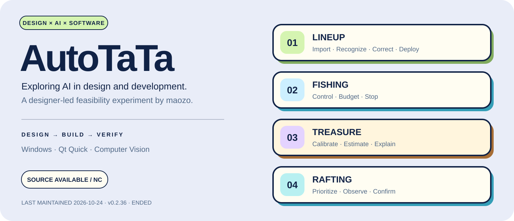

<p align="center"><a href="README.md">简体中文</a> · <strong>English</strong></p>

<p align="center"></p>

<p align="center"><strong>Designer-led · AI-assisted development · Windows desktop</strong><br />Source available · Noncommercial · Frozen at v0.2.36</p>

> **Maintenance has ended. Last functional maintenance / historical validation: 2026-10-24 (0.2.36); end-of-maintenance declaration: 2026-10-28.** This repository preserves the experiment and shares source for noncommercial use. No fixes, updates, answers, or support are promised, and Issues are disabled. This documentation update is dated 2026-11-01 and does not resume maintenance. See the [license scope (Chinese)](docs/legal/LICENSE_SCOPE.md) and [disclaimer (Chinese)](docs/legal/DISCLAIMER.md).

> **Compatibility:** the implementation targets the game, MuMu emulator, and dependency environment used during development / validation on 2026-10-24. It is not guaranteed to work with current or future releases of the game, emulator, operating system, or dependencies. “Latest” identifies this project's final historical package, not compatibility with the newest environment.

> **Current limitations: [known issues in 0.2.36](docs/KNOWN_ISSUES.en.md).** Four saved images still contain eight unconfirmed cells; four partial-board images require recapture. Complete real-game deployment remains pending retest. UI screenshots and offline checks are not guarantees of recognition accuracy or live success.

> **Interaction and treasure limitations:** typing in the manual character editor does not effectively narrow the candidate list. Treasure recognition still has errors, and complete continuous real-game testing of high-level stages is missing. These issues remain unresolved; presets for stages 1–24 do not mean all stages passed acceptance.

# AutoTaTa

**Turning interface decisions into working software.**

AutoTaTa is a personal experiment by designer **[maozo](https://github.com/maozo233)** to **explore the feasibility of AI in design and development**. Starting from an AI draft, the author designs, adjusts, and revises the work in Figma, then uses AI assistance to implement a Windows interface, image recognition, and automation flows. Saved-image replay and local checks help assess the results.

The project documents how design reaches code, where AI contributes, and how software should respond when recognition is uncertain or an operation fails.

[Interface gallery](#interface-gallery) · [Features](#four-features-one-interaction-language) · [Design and AI (Chinese)](docs/DESIGN_AND_AI.md) · [Known issues](docs/KNOWN_ISSUES.en.md) · [Reproduction boundaries (Chinese)](docs/SOURCE_DISTRIBUTION.md)

## Interface gallery

<p align="center"></p>

<table>
  <tr>
    <td width="50%"><strong>Lineup deployment</strong><br /></td>
    <td width="50%"><strong>Automatic fishing</strong><br /></td>
  </tr>
  <tr>
    <td><strong>Treasure assistant</strong><br /></td>
    <td><strong>Rafting</strong><br /></td>
  </tr>
</table>

These are actual 0.2.36 UI captures using isolated configuration examples and local calculations, with no device connected. Example lineups, budgets, and probabilities are not live results. Screenshot display does not transfer rights in third-party artwork. The README and banners are bilingual; the application UI shown here remains Chinese.

## Four features, one interaction language

| Feature | Implemented flow | Design focus |
| --- | --- | --- |
| Lineup deployment | Import, drop, or paste a lineup image; recognize, correct cells, find characters, and deploy; supports 5×5 and 3×4 | Show confirmed results first, preserve unknowns, and compare count, position, and identity before and after operations |
| Automatic fishing | Device and input mode, multiplier, bait replenishment, rod budget, start and stop | Clear hierarchy for configuration, feedback, and stopping; explicit budget and shutdown controls |
| Treasure assistant | Board calibration, item sizes and counts, probabilities, suggested cells, and cost estimates | Manual correction and understandable estimates; assists decisions without automatically digging |
| Rafting | Page recognition, multiplier, boat budget, six reward priorities, and stopping | Draggable visual priorities; stops or waits at purchase prompts or unknown pages |

The features share one desktop project and retain separate source entry points. The historical packaging policy builds the unified `all` package only. The [0.2.36 private Release](https://github.com/maozo233/AutoTaTa/releases/tag/v0.2.36) preserves the latest original archive for the author's review. It does not include new fixes for the issues reported here or relabel the entire historical binary under a new noncommercial license.

### Uncertainty is part of the interface

<p align="center"></p>

Recognition alone is not sufficient evidence to act. Lineup deployment distinguishes unknown, missing, out-of-range, and confirmed results, and allows manual correction. A cropped 5×5 board with missing empty rows requires a new capture; three or four rows are not stretched into a fabricated five-row lineup.

## My role and AI's contribution

The process includes **AI draft → author-led design and revisions in Figma → AI-assisted code implementation → the author's review and adjustment of the implementation**. Work in the Figma file is part of the author's design contribution, including decisions about the initial draft and subsequent changes to layout, hierarchy, components, and interaction details.

| Stage | Designer's decisions | AI assistance and evidence |
| --- | --- | --- |
| Product and interaction | Tasks, information hierarchy, feedback, stopping, and correction boundaries | Flow breakdown and implementation; see [application code](autotata) and [UI](assets/ui) |
| Figma design and components | Develop and revise the AI draft in Figma: page layout, visual hierarchy, typography, spacing, components, interaction states, and implementation review | Initial drafts and alternatives, followed by QML implementation and adaptation based on the approved Figma design; see [design iteration notes (Chinese)](docs/DESIGN_AND_AI.md#ai-初稿之后的-figma-设计迭代) |
| Graphics and asset processing | Asset selection, readability, edges, and transparency | AI-assisted cutouts for some entry and reward icons; derived artwork does not become the author's original copyrighted asset |
| Implementation and validation | Acceptable outcomes, real failure samples, and when uncertainty must remain | Computer vision, solvers, replay, and regression checks; see [validation summary (Chinese)](docs/VALIDATION_SUMMARY.md) |

AI primarily participates in the **development process**. Runtime recognition mainly uses local computer vision, template / feature matching, and OCR. It should not be described as an online language model understanding the game screen.

## What was verified, and what remains

Version 0.2.36 historically passed **197 lineup regression checks** and local native-window startup verification. Forty diagnostic records from two machines were deduplicated into 25 source images. Unknown cells decreased from 12 to 8, with no changes to previously confirmed identities in this comparison. Incomplete boards were explicitly rejected.

These are records from a particular historical environment, not a current or future accuracy guarantee. Diagnostic images and complete recognition assets are excluded from this showcase, so the full suite cannot be reproduced unchanged without them. **Complete real-game deployment in 0.2.36 remains pending retest.**

The [known issues page](docs/KNOWN_ISSUES.en.md) lists unresolved cell positions, manual-input filtering issues, treasure recognition and high-level-stage validation gaps, screenshot requirements, the retained real drag failure, and the repaired false stops. Maintenance has ended; the list is not a promise of future repairs.

## Source and reproduction

| Location | Contents |
| --- | --- |
| `assets/ui/` | Qt Quick pages, shared controls, and themes |
| `autotata/` | Home, navigation, windows, and shared runtime logic |
| `lineup/` | Recognition, correction, count checks, and deployment |
| `fishing/`, `treasure/`, `rafting/` | Feature logic, recognition, solvers, and state handling |
| `tests/` | Regression source; field images and game assets are excluded |
| `docs/` | Design notes, UI captures, limitations, and distribution boundaries |
| `docs/legal/`, `licenses/` | License scope, disclaimer, third-party sources, and original licenses |
| `scripts/`, `requirements/` | Windows launch / build scripts and build dependencies |

The root contains only the two READMEs, `LICENSE`, `NOTICE.md`, `requirements.txt`, `main.py`, and `.gitignore`. Maintenance and release notes live in `docs/`; contribution guidance lives in `.github/`. For the full local project, launch scripts are under `scripts/`, and individual features use `python -m lineup`, `-m treasure`, `-m fishing`, or `-m rafting`. Runtime prerequisites and excluded assets are described below and in the [usage notes (Chinese)](docs/USAGE.md).

This source snapshot **is not a complete runnable distribution**. Game artwork, recognition templates, diagnostic data, the AGPL-associated Android adapter, and third-party binaries are omitted. Check the resource boundary first; this command does not connect devices or download resources:

```powershell
python tools/check_source_assets.py
```

Local runtime research requires the necessary resources from lawful sources, following the [historical usage notes (Chinese)](docs/USAGE.md) and [distribution notes (Chinese)](docs/SOURCE_DISTRIBUTION.md). The project does not provide asset permissions, account operation, hosting, paid deployment, or support services.

## License, use, and maintenance

- **Human-created and AI-created contributions:** AI-generated, revised, or organized code, UI, documentation, and self-created graphics incorporated into this project **must follow the same [PolyForm Noncommercial 1.0.0](LICENSE) terms as human-created work. AI generation is not an exemption.** Uses outside the license's noncommercial permissions require separate authorization; retain the required notices and license and consult the actual terms. This applies only to rights the author can license; third-party content and AI processing of game artwork retain their original rights. See [license scope (Chinese)](docs/legal/LICENSE_SCOPE.md).
- **Third-party material:** dependencies, fonts, game artwork, and trademarks retain their own rights and licenses. They are not relicensed under the author's noncommercial terms. See [third-party notices (Chinese)](docs/legal/THIRD_PARTY_NOTICES.md).
- **Use risks:** an unofficial project with no guarantee of accuracy, compatibility, availability, or account safety; exclusions apply only where legally permitted. See the [disclaimer (Chinese)](docs/legal/DISCLAIMER.md).
- **Maintenance ended:** no promised updates, fixes, Issue / PR handling, or technical support. See [maintenance status (Chinese)](docs/MAINTENANCE.md).

This English overview is for accessibility. Linked Chinese legal and supporting documents remain in their original language; the English PolyForm license is available in full. README language links do not change the application's interface language or the license scope.

The repository and its Release remain private for the author's review. Any public visibility change requires a separate decision and review of both the source tree and Release attachments; this update does not make them public. See the [private review checklist (Chinese)](docs/PRIVATE_REVIEW.md).

<p align="center">Designed and directed by <a href="https://github.com/maozo233">maozo</a> · Built with AI assistance · Preserved as a finished experiment</p>
