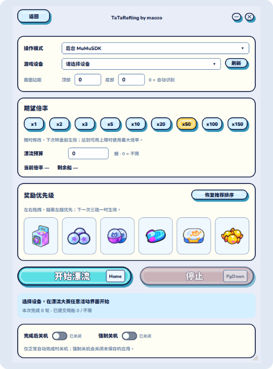
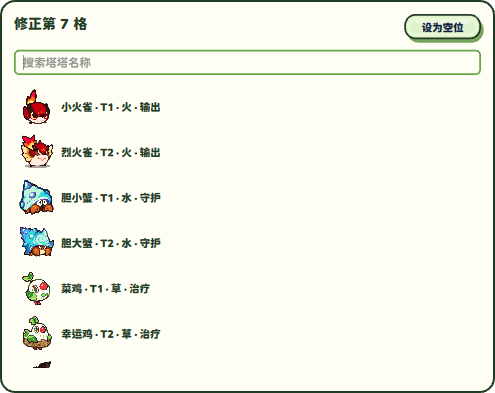

<p align="center"></p>
<h1 align="center">AutoTaTa</h1>
<p align="center">Unofficial Windows automation for 塔塔冒险队. Deploy a lineup from an image, set fishing and rafting budgets, and compare treasure locations.</p>
<p align="center"><a href="README.md">简体中文</a> · <strong>English</strong> &nbsp;·&nbsp; <a href="#interactions">Interactions</a> &nbsp;·&nbsp; <a href="docs/KNOWN_ISSUES.en.md">Known issues</a></p>


## At a glance

Four tasks share one desktop app. Select a preview for the full screen. The captures show version 0.2.36 with example settings and offline calculations.

<table>
  <tr>
    <td width="50%" valign="top"><a href="docs/media/lineup.png"></a><br /><strong>Lineup</strong><br />Import a formation and check uncertain cells.</td>
    <td width="50%" valign="top"><a href="docs/media/fishing.png"></a><br /><strong>Fishing</strong><br />Set the multiplier, bait and rod budget.</td>
  </tr>
  <tr>
    <td width="50%" valign="top"><a href="docs/media/treasure.png"></a><br /><strong>Treasure</strong><br />Mark the board and compare the odds.</td>
    <td width="50%" valign="top"><a href="docs/media/rafting.png"></a><br /><strong>Rafting</strong><br />Choose a multiplier and a boat budget.</td>
  </tr>
</table>

## Interactions

**Drag to rank rewards.** The leftmost reward has first priority. Moving an item changes which reward the assistant will choose when several are offered.

<!-- Motion slot: replace this still with a looping reward reorder capture at the same aspect ratio. Keep the static fallback. -->
<p align="center"><a href="docs/media/rafting.png"></a></p>

<details>
<summary><strong>Correct a lineup cell</strong></summary>

Importing a screenshot starts recognition and attempts deployment. A question mark means the character’s identity is uncertain. Stop the run, wait for it to finish, then open the cell to choose a character or mark it empty. A five-row board cropped down to four rows needs a new capture because the missing row changes the positions.

<!-- Motion slot: the editor still can be replaced by a short local correction recording. -->
<p align="center"></p>

</details>

## Design & implementation

I’m [maozo](https://github.com/maozo233), the designer of AutoTaTa. I built it to explore how AI could help me take a desktop interaction from draft to working software. Starting with an AI draft, I set the layout, typography and control states in Figma. AI helped implement the screens in QML and connect them to Python through PySide6. I reviewed the running Windows interface and used failed captures to decide when a character should keep its question mark. [Design notes (Chinese)](docs/DESIGN_AND_AI.md)

**On screen.** The home window has four task entries. Device settings, budgets and stop controls live inside the task they affect. [Home screen](docs/media/home.png) · [QML components](assets/ui)

**Under the hood.** Local image matching and OCR read the game screen. Lineup deployment checks character identity, position and count. The treasure solver enumerates possible layouts and switches to sampling when the search grows too large. The player chooses where to dig. [Lineup code](lineup) · [Solver](treasure/solver.py)

## Results & known issues

In a replay of 25 distinct images from 40 records across two machines, unknown cells fell from **12 to 8**. Previously confirmed identities stayed the same. Version 0.2.36 passed **197 lineup regression checks**. A full in-game deployment still awaits a retest. [Validation notes (Chinese)](docs/VALIDATION_SUMMARY.md)

- Some dropdown clicks reach the control underneath.
- Lineup recognition can misidentify characters. Typing in the manual editor can fail to narrow the list.
- Treasure board recognition still makes errors. Higher stages lack continuous in-game testing. [Known issues](docs/KNOWN_ISSUES.en.md)

## Source & status

**0.2.36 · Maintenance ended.** The last functional update was October 24, 2026. I announced the end of maintenance on October 28 because of time constraints and because I had stopped playing. Compatibility with newer game or emulator versions is unverified. Issues are closed, with no further updates or support planned. [Maintenance record (Chinese)](docs/MAINTENANCE.md)

The public snapshot contains source and design materials. The bundled executable, game asset packs, recognition templates, field captures and some runtime dependencies are unavailable here. From the repository root, you can inspect the resource list and run the standalone treasure tests in the documented environment. [Reproduction guide (Chinese)](docs/SOURCE_DISTRIBUTION.md)

```powershell
python tools/check_source_assets.py
python -m unittest tests.test_treasure_solver tests.test_treasure_enumeration
```

**License.** Human and AI contributions that the author can license share the PolyForm Noncommercial 1.0.0 terms. Commercial use requires separate permission. Retain the license and required notices. Third-party software, fonts, trademarks and game artwork, including artwork visible in the screenshots, retain their own rights. [License](LICENSE) · [Scope](docs/legal/LICENSE_SCOPE.md) · [Third-party notices](docs/legal/THIRD_PARTY_NOTICES.md) · [Disclaimer](docs/legal/DISCLAIMER.md)
