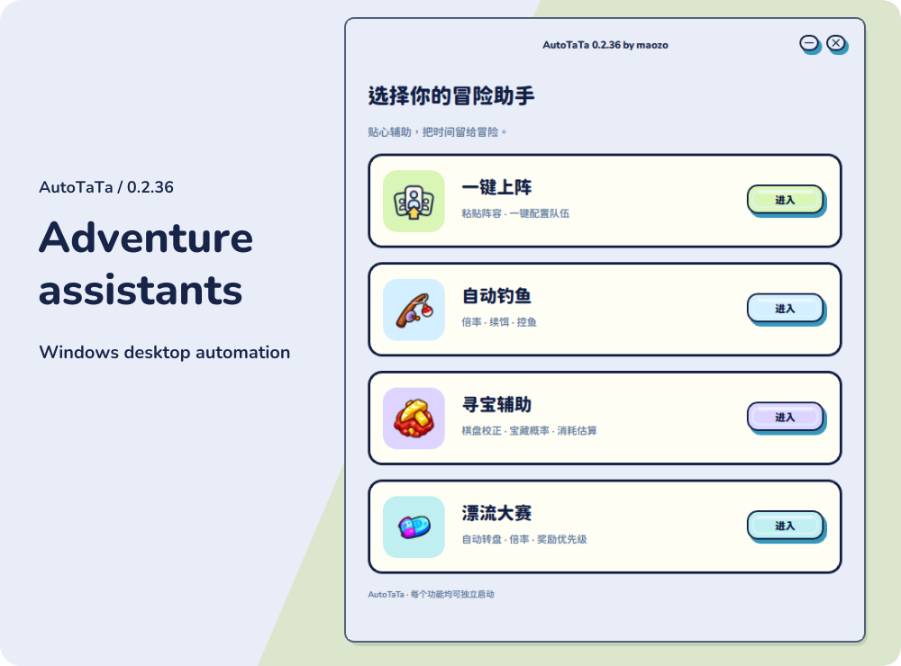
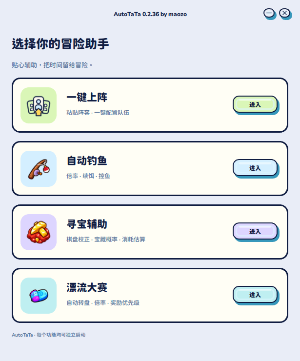
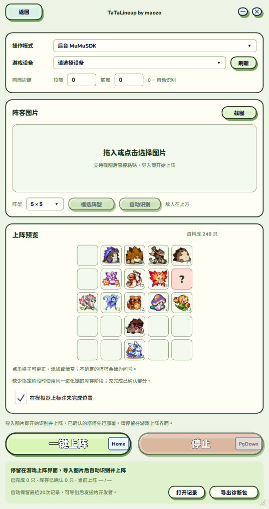
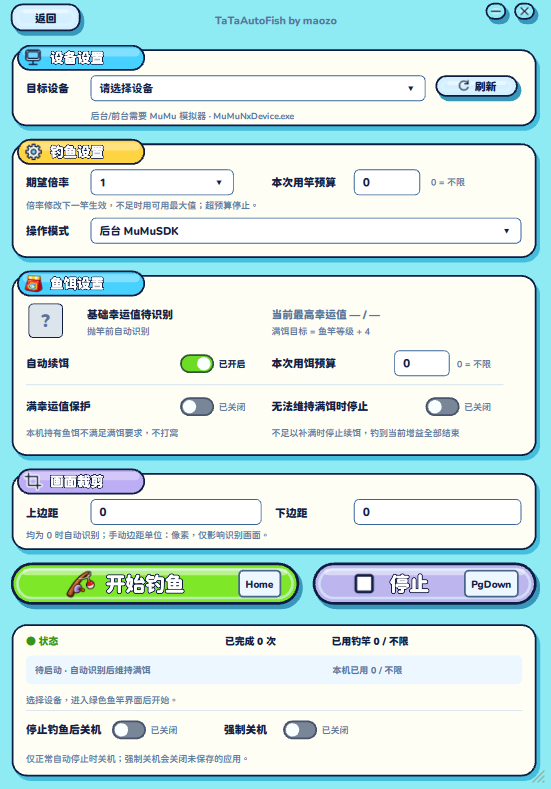
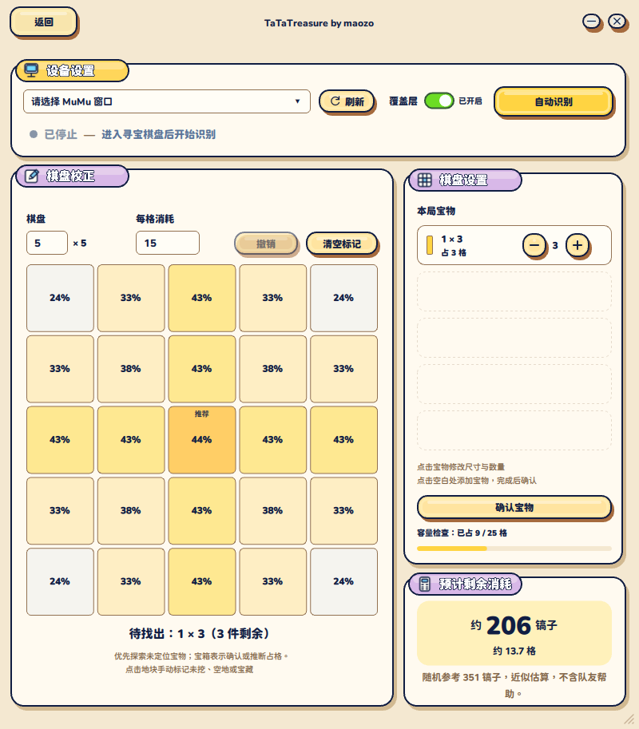
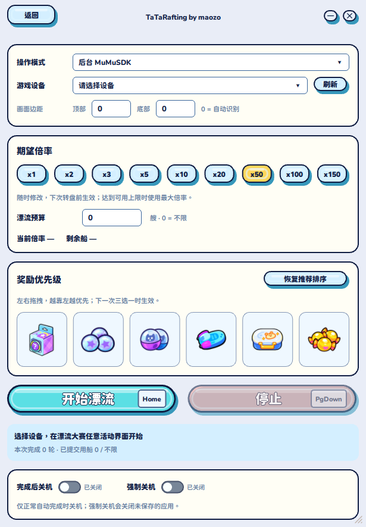

<p align="center"><a href="README.md">简体中文</a> · <strong>English</strong></p>



# AutoTaTa

An unofficial Windows tool for players of **塔塔冒险队**. Players can deploy a lineup from a screenshot, set a fishing budget, compare treasure locations, or rank rafting rewards in one desktop app.

<p align="center"></p>

## Overview

Following a lineup guide means identifying each character and placing it in the right cell. If a screenshot crops out an empty row, even correctly identified characters can land in the wrong positions. AutoTaTa turns the image into a board the player can inspect and correct, then checks the game screen to see what actually landed.

I’m **maozo**, the designer behind this personal experiment. I wanted to see how far AI could help me take an interaction from a design file to working software. **Version 0.2.36 was the final release. Maintenance has ended.** This repository shares the UI, source snapshot and validation notes for noncommercial study. There is no public installer.

## My role

I defined the four tasks, their controls, and the points where the player needs to make a decision. Starting from an AI draft, I revised the layouts and visual hierarchy in **Figma**, adjusted type and spacing, and designed button, picker and dialog states. I then checked how those choices held up in a running Windows application.

AI helped translate the approved designs into QML, connect them to Python, and implement recognition and regression checks. I reviewed failed captures from two machines and decided which cells had enough evidence to identify a character and which should keep a question mark. [Design process (Chinese)](docs/DESIGN_AND_AI.md)

## Demo & screens

These captures show the actual 0.2.36 interface with example settings and offline calculations. The application UI is in Chinese.

**Lineup deployment.** Pasting, dropping or importing an image starts recognition and attempts deployment automatically. To correct a cell, stop the operation, wait for it to finish, then use the editor to select a character or mark the cell as empty.

<p> </p>

**Fishing.** Choose a device and multiplier, configure bait replenishment, and set a rod budget to limit consumption during a run.



**Treasure assistant.** Calibrate the board, correct cell markings, and enter the size and count of each item. The solver estimates probabilities and costs and suggests a cell. The player chooses where to dig.



**Rafting.** Drag six reward types into priority order and set a boat budget. A purchase prompt or an unfamiliar screen stops or pauses the flow.



## Design decisions

- **Give uncertainty its own cell state.** The board distinguishes a confirmed character, an empty cell and an unknown character. If a five-row formation is missing an entire row, even an empty one, the app asks for a new capture. Players can tell when to correct a character and when to recapture the whole board.
- **Keep the home screen to four choices.** Device settings, budgets and stop controls appear inside the relevant task. Cards, fields and buttons work the same way across screens, while each task has its own theme and icon. [UI components](assets/ui)
- **Make the order itself editable.** Rafting needs a preference order. Dragging the rewards into a list lets the player read their priority from top to bottom without comparing six numeric weights.

## Implementation

Qt Quick and QML render the interface, with PySide6 connecting it to Python. Local computer vision, template matching and OCR read the game screen. Deployment checks positions, counts and character identities. The treasure solver enumerates layouts that fit the known cells and item shapes, then uses sampling when the search becomes too large. [Lineup implementation](lineup) · [Treasure solver](treasure/solver.py)

On October 24, 2026, a replay compared 25 distinct images from 40 diagnostic records across two machines. On that set, **unknown cells fell from 12 to 8**, and every previously confirmed identity stayed the same. Version 0.2.36 passed **197 lineup regression checks** at the time. A complete in-game deployment still awaits a retest. [Validation notes (Chinese)](docs/VALIDATION_SUMMARY.md)

From the repository root, the first command lists missing runtime resources offline. With the documented Python environment, the second runs the standalone treasure solver tests. [Environment and reproduction guide (Chinese)](docs/SOURCE_DISTRIBUTION.md)

```powershell
python tools/check_source_assets.py
python -m unittest tests.test_treasure_solver tests.test_treasure_enumeration
```

## Status & roadmap

The last functional update was **October 24, 2026**. I announced the end of maintenance on **October 28, 2026**, due to personal time constraints and because I had stopped playing the game. Compatibility is limited to the game and emulator versions used at the time. Issues are closed, with no further updates, fixes or technical support planned. [Maintenance record (Chinese)](docs/MAINTENANCE.md)

- Some dropdown clicks pass through to the control underneath.
- Lineup recognition can misidentify characters. When adding or correcting a character manually, typing a name can fail to narrow the list.
- Treasure board recognition still makes errors. Higher stages lack continuous in-game testing. [Full list of known issues](docs/KNOWN_ISSUES.en.md)

## License & source availability

Code, UI, documentation and graphics that the author can license are available under **PolyForm Noncommercial 1.0.0**. The same terms apply to human contributions and incorporated AI-generated or AI-revised work within that scope. Commercial use requires separate permission. Use and redistribution must follow the license and retain the required notices. [License](LICENSE) · [License scope (Chinese)](docs/legal/LICENSE_SCOPE.md)

Game artwork, trademarks, fonts and third-party components retain their respective rights. The snapshot omits game asset packs, recognition templates, field captures, Android adapter components and third-party binaries. Compatibility with current versions and account safety are not guaranteed. [Third-party notices (Chinese)](docs/legal/THIRD_PARTY_NOTICES.md) · [Disclaimer (Chinese)](docs/legal/DISCLAIMER.md)

## Contact & portfolio

[maozo on GitHub](https://github.com/maozo233)
