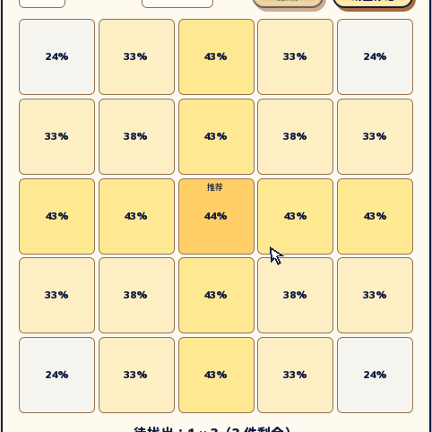

<p align="center"></p>
<h1 align="center">AutoTaTa</h1>
<p align="center">An unofficial Windows automation tool for 塔塔冒险队. Deploy a lineup from a guide, set budgets for fishing and rafting, or compare treasure tiles before you dig.</p>
<p align="center"><a href="README.md">简体中文</a> · <strong>English</strong> &nbsp;·&nbsp; <a href="#interactions">Interactions</a> &nbsp;·&nbsp; <a href="docs/KNOWN_ISSUES.en.md">Known issues</a></p>


## Why AutoTaTa?

A guide gives players a picture of a formation. Recreating it means finding the right characters in their own inventory and placing each one on the board. Fishing and rafting have a different problem: repetitive actions spend rods and boats. AutoTaTa brings those tasks into one desktop app, where players can set a goal, correct a misread and stop a run.

**Windows · 0.2.36 · Maintenance ended**　Select a preview for the full interface.

<table>
  <tr>
    <td width="50%" valign="top"><a href="docs/media/lineup.png"></a><br /><strong>Lineup</strong><br />Import a formation and check uncertain cells.</td>
    <td width="50%" valign="top"><a href="docs/media/fishing.png"></a><br /><strong>Fishing</strong><br />Set the multiplier, bait and rod budget.</td>
  </tr>
  <tr>
    <td width="50%" valign="top"><a href="docs/media/treasure.png"></a><br /><strong>Treasure</strong><br />Mark the board and compare the odds.</td>
    <td width="50%" valign="top"><a href="docs/media/rafting.png"></a><br /><strong>Rafting</strong><br />Choose a multiplier and a boat budget.</td>
  </tr>
</table>

## Interactions

These three loops show the actual 0.2.36 interface with a sample lineup and board. The pointer follows each action. All three were captured offline.

### Lineup · Clear an uncertain tile

Pasting or dropping a formation image starts recognition and attempts deployment. Confirmed characters go first. A question mark flags an uncertain identity. In the example, the player opens the tenth tile and selects **Set empty** (设为空位). Once the editor closes, the preview shows the cleared tile. During a run, stop and wait for deployment to finish before editing.

<p align="center"><a href="docs/media/lineup-editor.png"><picture><source media="(prefers-reduced-motion: reduce)" srcset="docs/media/lineup-editor.png" /></picture></a></p>

Both 5×5 and 3×4 formations need the entire friendly board. Crop out opponents and buttons from a wide screenshot. If a row is already missing from a five-row board, capture it again, even if that row was empty. [Lineup guide (Chinese)](docs/USAGE.md#一键上阵第一版)

### Treasure · Mark a tile and watch the odds change

The center tile starts as the recommended dig. Mark it **Empty** (标为空地) and the recommendation shifts to four surrounding tiles. Players can also correct treasure dimensions and quantities, then compare the estimated cost of finishing. The player chooses where to dig.

<p align="center"><a href="docs/media/treasure.png"><picture><source media="(prefers-reduced-motion: reduce)" srcset="docs/media/treasure.png" /></picture></a></p>

### Rafting · Drag a reward into first place

Rewards are ranked from left to right. Moving the third card to the front gives it priority the next time the game offers three choices. A separate budget limits boats spent. Free spins do not use that budget, and a boat purchase prompt stops the run.

<p align="center"><a href="docs/media/demo-reward-order.svg"><picture><source media="(prefers-reduced-motion: reduce)" srcset="docs/media/demo-reward-order.svg" /></picture></a></p>

### Fishing · Set a rod budget before casting

Choose the multiplier, bait refill behavior and rod budget before starting. Rod usage reflects the multiplier. Progress and the stop control stay in the fishing window. [View the fishing screen](docs/media/fishing.png)

## Design decisions

- **Give each task its own controls.** The home screen has four entries. Multipliers, budgets, progress and the stop button appear inside the task they affect. [Home screen](docs/media/home.png)
- **Make uncertainty editable.** Empty tiles, identified characters and uncertain matches have distinct states. A player can correct one tile while keeping every confirmed position. [Cell editor](docs/media/lineup-editor.png)
- **Put the evidence next to the recommendation.** The treasure board shows the odds on each tile and highlights suggested digs. Treasure shapes and estimated costs sit alongside the grid so players can check the inputs behind a suggestion. [Treasure screen](docs/media/treasure.png)

## Design & implementation

AutoTaTa explores how AI can contribute to product design and development. The designer defined the scope, interaction flows and visual system. Starting from an AI draft, the designer revised layouts, typography and component states in Figma, then checked them in the running Windows app. AI assisted with QML and Python implementation, failure analysis and regression checks. The designer reviewed the outcomes and decided where uncertainty should interrupt automation. [Design process (Chinese)](docs/DESIGN_AND_AI.md)

The UI uses Qt Quick and PySide6. Local image matching and OCR read the game screen. Lineup deployment checks character identity, position and count. The treasure solver enumerates layouts consistent with the player's marks and labels its results as estimates when it switches to sampling. [UI components](assets/ui) · [Lineup implementation](lineup) · [Treasure solver](treasure/solver.py)

## Results, known issues & status

Forty records from two machines contained 25 distinct source images. Replaying that set reduced uncertain cells **from 12 to 8** while preserving previously confirmed identities. Version 0.2.36 passed **197 lineup regression checks**. End-to-end deployment in the game was still awaiting a retest when maintenance ended. [Validation notes (Chinese)](docs/VALIDATION_SUMMARY.md)

- **Lineup** can miss or misidentify characters. Typing in the manual editor sometimes fails to narrow the candidate list.
- **Treasure** can misread the board. Presets cover stages 1–24, but higher stages lack continuous in-game testing.
- **Some dropdowns** let a click reach the control underneath. [All known issues](docs/KNOWN_ISSUES.en.md)

The last functional update was **October 24, 2026**. Maintenance ended on **October 28, 2026** due to time constraints and the designer no longer playing the game. Version 0.2.36 reflects the game and emulator of that period. Compatibility with current versions is unverified. Issues are closed and no further fixes are planned. [Maintenance record (Chinese)](docs/MAINTENANCE.md)

## Source, license & contact

The repository provides source and design materials. The bundled executable, game asset packs, recognition templates, field captures and some runtime dependencies are unavailable here. With the documented environment, you can inspect the resource inventory and run the standalone treasure solver tests from the repository root. [Environment and reproduction guide (Chinese)](docs/SOURCE_DISTRIBUTION.md)

```powershell
python tools/check_source_assets.py
python -m unittest tests.test_treasure_solver tests.test_treasure_enumeration
```

Human and AI contributions that the author can license are covered by PolyForm Noncommercial 1.0.0. Commercial use requires separate permission. Retain the license and required notices. Third-party software, fonts, trademarks and game artwork visible in screenshots retain their respective rights. [License](LICENSE) · [Scope](docs/legal/LICENSE_SCOPE.md) · [Third-party notices](docs/legal/THIRD_PARTY_NOTICES.md) · [Disclaimer](docs/legal/DISCLAIMER.md)

[Portfolio](https://portfolio-site-ck8.pages.dev/) · [Contact](https://portfolio-site-ck8.pages.dev/#contact)
