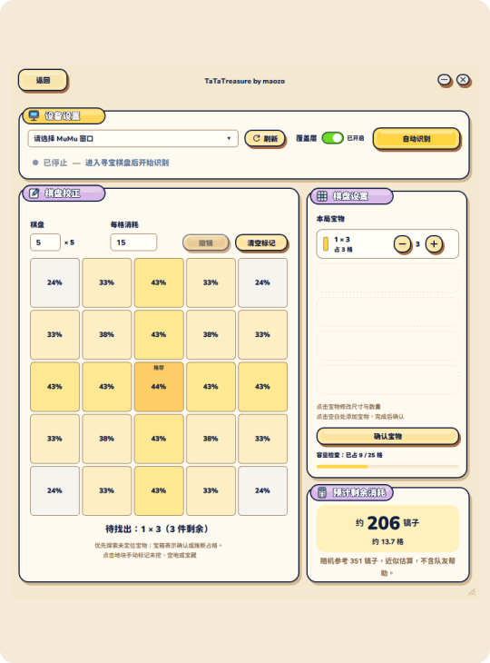

<p align="center"></p>
<h1 align="center">AutoTaTa</h1>
<p align="center">《塔塔冒险队》的非官方 Windows 自动化工具。照着攻略排阵，按预算钓鱼和漂流，在寻宝棋盘上比较下一铲挖哪里。</p>
<p align="center"><strong>简体中文</strong> · <a href="README.en.md">English</a> &nbsp;·&nbsp; <a href="#交互演示">交互演示</a> &nbsp;·&nbsp; <a href="docs/KNOWN_ISSUES.md">已知问题</a></p>


## 为什么做 AutoTaTa

攻略给出的是一张阵容图，玩家面对的却是自己的库存和棋盘。钓鱼、漂流要反复操作，还得留意鱼竿和船的消耗。AutoTaTa 把这些任务放进同一个桌面窗口，让玩家设定目标、纠正识别结果，也能在中途叫停。

**Windows · 0.2.36 · 已停止维护**　点击下方预览可看完整界面。

<table>
  <tr>
    <td width="50%" valign="top"><a href="docs/media/lineup.png"></a><br /><strong>一键上阵</strong><br />导入阵容图，核对未确认的格子。</td>
    <td width="50%" valign="top"><a href="docs/media/fishing.png"></a><br /><strong>自动钓鱼</strong><br />设置倍率、补饵方式和用竿预算。</td>
  </tr>
  <tr>
    <td width="50%" valign="top"><a href="docs/media/treasure.png"></a><br /><strong>寻宝辅助</strong><br />标记棋盘，比较各格的宝物概率。</td>
    <td width="50%" valign="top"><a href="docs/media/rafting.png"></a><br /><strong>漂流大赛</strong><br />选择漂流倍率，限定本次用船数。</td>
  </tr>
</table>

## 交互演示

以下三个循环录自 0.2.36 的本地界面，使用示例阵容与棋盘。鼠标指针标出操作位置，全程未连接游戏。

### 一键上阵 · 把问号改成空位

粘贴或拖入阵容图，就会开始识别并尝试上阵。已确认的角色先行处理，问号留给玩家核对。示例把第十格更正为空位。点开问号，选择「设为空位」，即可在预览里看到更正。运行中要先停止，等本次操作结束再编辑。

<p align="center"><a href="docs/media/lineup-editor.png"><picture><source media="(prefers-reduced-motion: reduce)" srcset="docs/media/lineup-editor.png" /></picture></a></p>

截图范围影响站位。5×5 和 3×4 阵容都要保留完整己方场地。大截图可框掉敌方和底部按钮；如果五行棋盘已经截掉一整行，即使缺的是空行，也要重新截图。[阵容导入说明](docs/USAGE.md#一键上阵第一版)

### 寻宝辅助 · 标一格，看整盘概率怎样变

下面的棋盘起初推荐正中央的一格。点开它，标为「空地」，中心就显示为「空」，推荐随即移到四周。宝物尺寸或数量有误时也可以修正，再比较剩余消耗估算。最终挖哪一格由玩家决定。

<p align="center"><a href="docs/media/treasure.png"><picture><source media="(prefers-reduced-motion: reduce)" srcset="docs/media/treasure.png" /></picture></a></p>

### 漂流大赛 · 把想要的奖励拖到最前面

奖励从左到右排列。把第三项拖到第一位，下一次三选一时就会优先选它。漂流另有用船预算，免费转盘不计入消耗。遇到购船窗口，程序会停止。

<p align="center"><a href="docs/media/demo-reward-order.svg"><picture><source media="(prefers-reduced-motion: reduce)" srcset="docs/media/demo-reward-order.svg" /></picture></a></p>

### 自动钓鱼 · 给一次挂机设定用竿上限

开钓前可以设置倍率、补饵方式和用竿预算。按倍率计入鱼竿消耗后，玩家能在同一个窗口查看进度或停止本次钓鱼。[查看钓鱼界面](docs/media/fishing.png)

## 设计取舍

- **把任务选择和运行控制分开。** 主页只放四个入口。倍率、预算、状态和停止按钮留在对应任务页，玩家看到数值时就知道它影响哪项活动。[主页全图](docs/media/home.png)
- **给不确定的识别一个可编辑的状态。** 空位、角色和问号有三种显示方式。玩家可以只更正有疑问的一格，保留其余已经确认的站位。[阵容编辑器](docs/media/lineup-editor.png)
- **让建议可以核对。** 寻宝棋盘直接显示逐格概率，用颜色标出推荐位置；宝物配置和消耗估算放在棋盘旁，方便对照输入与结果。[寻宝全图](docs/media/treasure.png)

## 设计分工与实现

AutoTaTa 也是一次关于 AI 在设计与开发中能做到什么的实验。产品范围、操作流程和视觉取舍由设计者确定。以 AI 初稿为起点，在 Figma 中重新组织布局、调整字号与组件状态，再对照 Windows 窗口核验还原效果。AI 辅助编写 QML 和 Python、整理失败样本与回归检查；最终由设计者判断识别结果是否可信、哪些操作应当停下。[设计与 AI 协作记录](docs/DESIGN_AND_AI.md)

界面采用 Qt Quick 和 PySide6。本地图像匹配与 OCR 读取画面，上阵流程核对角色身份、位置和数量。寻宝求解器枚举与标记相符的布局，搜索量过大时改用采样，并标明结果为估算。[界面组件](assets/ui) · [上阵实现](lineup) · [寻宝求解器](treasure/solver.py)

## 验证、已知问题与维护状态

两台机器的 40 条记录去重后得到 25 张原图。在同一组回放中，未确认格子从 **12 格降至 8 格**，原先已确认的角色身份保持一致。0.2.36 通过了 **197 项一键上阵回归检查**，该版本在游戏中从导入到完成上阵的全流程仍待复测。[历史验证摘要](docs/VALIDATION_SUMMARY.md)

- **一键上阵**仍会漏认或认错角色。手动添加或更正时，输入关键词有时无法缩小候选列表。
- **寻宝辅助**仍会认错棋盘。1–24 关有预设，高等级关卡缺少真实、连续的操作验证。
- **部分下拉菜单**会让点击穿透，触发下方控件。[完整已知问题](docs/KNOWN_ISSUES.md)

最后功能维护于 **2026-10-24**，**2026-10-28** 宣布停维。因个人时间安排及不再游玩，功能冻结于 0.2.36。兼容性以当时的游戏和模拟器版本为限，不保证最新版可用。Issues 已关闭，无后续修复排期。[维护记录](docs/MAINTENANCE.md)

## 源码、许可与联系

仓库公开源码与设计资料，不提供整合安装包。游戏图包、识别模板、现场诊断图及部分运行依赖未随库分发。准备好文档列出的环境后，可在仓库根目录检查资源清单，或独立运行寻宝求解测试。[环境与复现说明](docs/SOURCE_DISTRIBUTION.md)

```powershell
python tools/check_source_assets.py
python -m unittest tests.test_treasure_solver tests.test_treasure_enumeration
```

作者有权授权的人工与 AI 创作部分均适用 PolyForm Noncommercial 1.0.0。商业性使用须另获许可，使用时须依许可原文保留相应声明。第三方软件、字体、商标和截图中的游戏美术保留各自权利。[许可证](LICENSE) · [授权范围](docs/legal/LICENSE_SCOPE.md) · [第三方说明](docs/legal/THIRD_PARTY_NOTICES.md) · [免责声明](docs/legal/DISCLAIMER.md)

[作品集](https://portfolio-site-ck8.pages.dev/) · [公开联系入口](https://portfolio-site-ck8.pages.dev/#contact)
