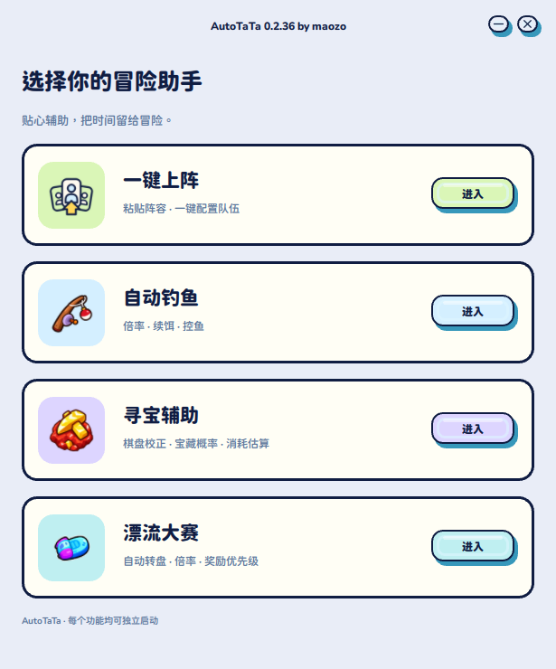
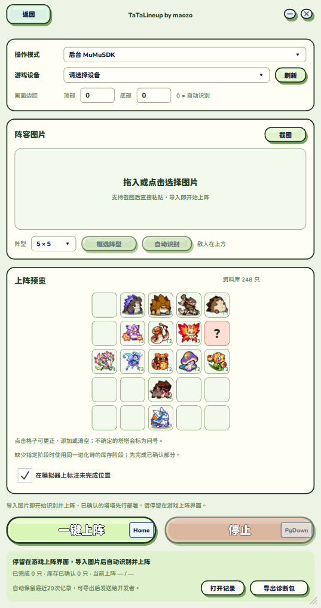
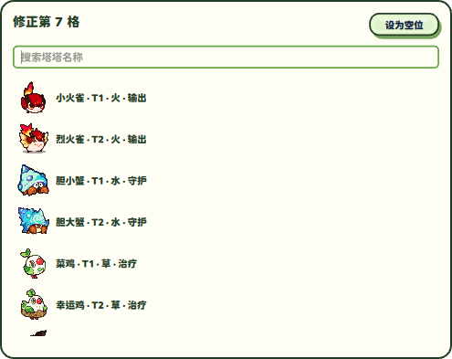
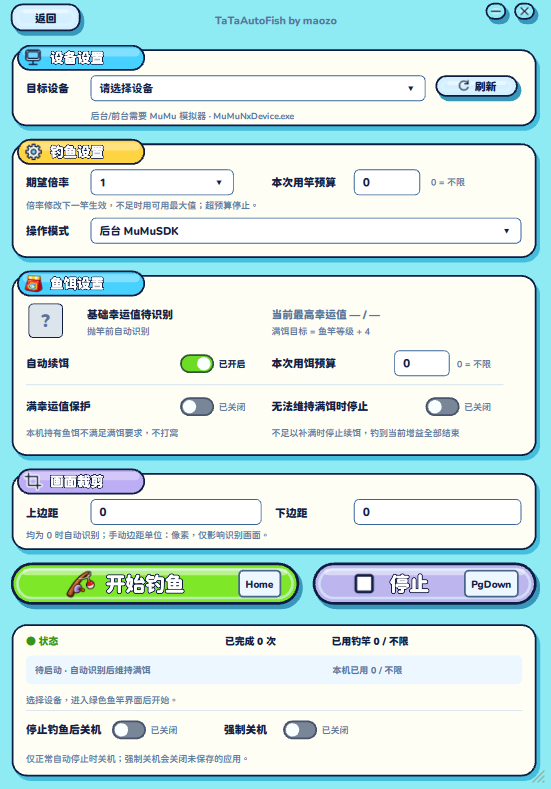
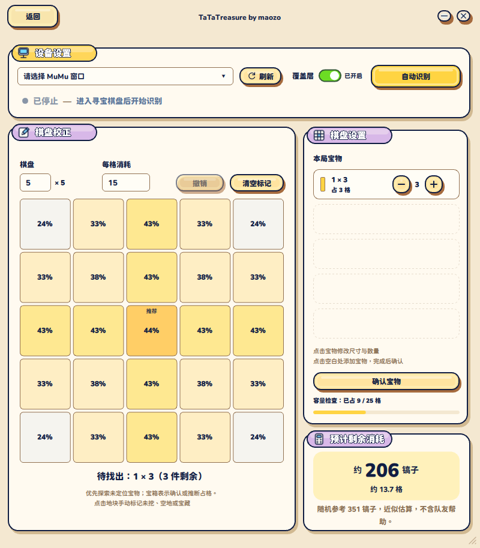
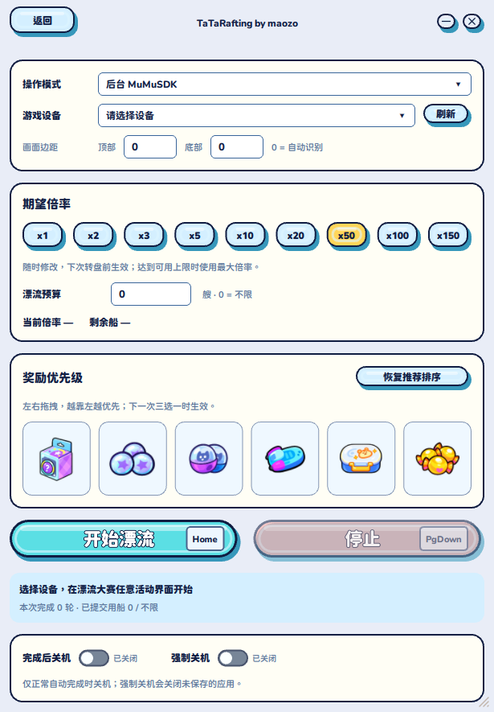

<p align="center"><strong>简体中文</strong> · <a href="README.en.md">English</a></p>


# AutoTaTa

《塔塔冒险队》的非官方 Windows 自动化工具。玩家可以从一张阵容截图开始上阵，也可以在同一个桌面窗口里设置钓鱼、估算寻宝落点或安排漂流奖励。

<p align="center"></p>

## 项目概览

对照攻略图上阵时，玩家既要认出角色，又要把它放进对应格子。一张裁掉底部空行的截图，即使每个角色都认对了，也可能让整队站错位置。AutoTaTa 把阵容图变成可检查、可更正的棋盘，再根据游戏画面核对上阵结果。

这是设计师 **maozo** 发起的个人实验，想验证 AI 能在多大程度上帮助设计师把交互想法做成能运行的软件。历史发布版本为 **0.2.36，现已停止维护**。本仓库公开界面、实现与验证记录，供非商业研究，目前不提供安装包下载。

## 我的职责

我确定了四个功能的范围、操作顺序，以及什么时候应把判断交还给玩家。AI 给出初稿后，我在 **Figma** 里重新安排页面布局和信息层级，调整字号、间距、按钮、选择器及弹窗状态，再对照 Windows 实际窗口检查还原效果。

AI 根据确认后的设计辅助编写 QML、连接 Python 业务逻辑，也参与识别算法和回归用例的实现。我用两台机器留下的失败截图核对结果，决定哪些格子可以确认，哪些必须继续显示问号。[设计与 AI 协作记录](docs/DESIGN_AND_AI.md)

## 界面与操作演示

以下是 0.2.36 的真实程序截图，使用示例配置和离线计算结果。截图中的界面语言为中文。

**一键上阵。** 粘贴、拖入或导入阵容图后，程序会尝试识别并自动上阵。要改一个格子，先停止并等待运行结束，再打开更正窗口，选择角色或标为空位。

<p> </p>

**自动钓鱼。** 玩家选择设备和倍率、设置补饵方式，并用竿数预算限定一次运行的消耗。



**寻宝辅助。** 玩家校准棋盘、修正格子并填写宝物尺寸与数量。程序给出概率、推荐格和消耗估算，实际挖哪一格由玩家决定。



**漂流大赛。** 玩家拖动六类奖励来排列优先级，并设定用船预算。遇到购买提示或未知页面时，流程会停止或等待。



## 设计取舍

- **给未知角色留一个格子。** 上阵棋盘分别显示已确认角色、空位和问号。如果本应有五行的截图缺了整行，即使缺的是空行，程序也会提示重截。这样用户能区分「需要认角色」和「需要重截整张图」。
- **主页只做任务选择。** 设备、预算和停止方式放进各自的功能页，让玩家选中当下要做的事后再看参数。不同功能沿用同一组卡片、字段和按钮，靠主题与图形区分入口。[界面组件](assets/ui)
- **用顺序表达偏好。** 漂流奖励要表达的是「先选哪个」。拖动后从上往下就是实际优先级，玩家可以直接检查顺序，无需把六个数字换算成排名。

## 技术实现与验证

桌面界面使用 Qt Quick / QML，通过 PySide6 连接 Python。上阵时，本地计算机视觉、模板匹配和 OCR 读取画面，部署流程核对位置、数量和角色身份。寻宝求解器根据已知格子与宝物形状枚举可能布局，搜索量过大时使用采样估算。[上阵实现](lineup) · [寻宝求解器](treasure/solver.py)

在 2026-10-24 的历史回放中，两台机器的 40 条记录去重后得到 25 张原图。对同一批图片，未确认格子从 **12 格降到 8 格**，此前已确认的角色身份均保持一致。0.2.36 当时通过了 **197 项一键上阵回归检查**。完整的实机上阵流程仍待复测。[验证摘要](docs/VALIDATION_SUMMARY.md)

可在项目根目录离线检查公开快照缺少哪些运行资源。准备好文档所列的 Python 环境后，还可以独立运行寻宝求解测试。[环境与复现说明](docs/SOURCE_DISTRIBUTION.md)

```powershell
python tools/check_source_assets.py
python -m unittest tests.test_treasure_solver tests.test_treasure_enumeration
```

## 当前状态与已知问题

最后功能维护于 **2026-10-24**，停维声明发布于 **2026-10-28**。因个人时间安排，且我已不再游玩这款游戏，项目已结束维护。兼容性以当时的游戏和模拟器版本为限。Issues 已关闭，无后续更新、修复排期或技术支持。[维护记录](docs/MAINTENANCE.md)

- 部分下拉菜单会发生点击穿透，误触下层控件。
- 一键上阵仍会识别出错。手动添加或更正角色时，输入关键词有时无法缩小候选范围。
- 寻宝仍有棋盘识别错误。高等级关卡缺少真实、连续的操作验证。[完整问题清单](docs/KNOWN_ISSUES.md)

## 许可与源码范围

作者有权授权的代码、界面、文档和自制图形采用 **PolyForm Noncommercial 1.0.0**。纳入项目的 AI 生成或修改内容与人工创作部分适用相同条款。商业性使用须另获许可，使用与再分发须遵守原文并保留相应声明。[许可证](LICENSE) · [授权范围](docs/legal/LICENSE_SCOPE.md)

游戏美术、商标、字体及第三方组件各自保留原有权利。公开快照省略了游戏图包、识别模板、现场诊断图、Android 适配组件及第三方二进制。项目不保证当前版本可用或账号安全。[第三方说明](docs/legal/THIRD_PARTY_NOTICES.md) · [免责声明](docs/legal/DISCLAIMER.md)

## 作者与其他作品

[maozo 的 GitHub 主页](https://github.com/maozo233)
