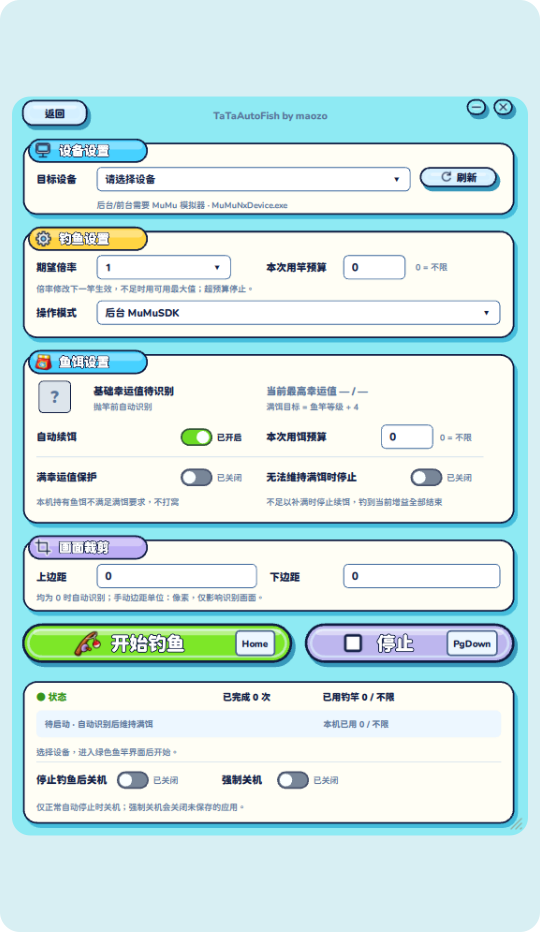
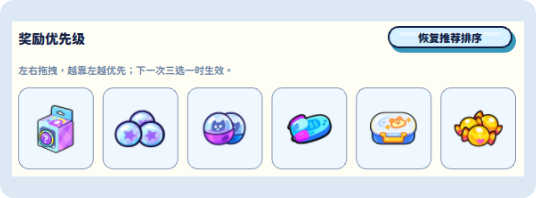

<p align="center"></p>
<h1 align="center">AutoTaTa</h1>
<p align="center">《塔塔冒险队》非官方 Windows 自动化工具。从攻略图导入阵容，设置钓鱼和漂流预算，在寻宝棋盘上比较落点。</p>
<p align="center"><strong>简体中文</strong> · <a href="README.en.md">English</a> &nbsp;·&nbsp; <a href="#交互演示">交互演示</a> &nbsp;·&nbsp; <a href="docs/KNOWN_ISSUES.md">已知问题</a></p>


## 功能预览

四个任务共用一个桌面程序。点击预览可查看完整界面。截图来自 0.2.36 的示例配置与离线计算。

<table>
  <tr>
    <td width="50%" valign="top"><a href="docs/media/lineup.png"></a><br /><strong>一键上阵</strong><br />导入阵容图，核对未确认的格子。</td>
    <td width="50%" valign="top"><a href="docs/media/fishing.png"></a><br /><strong>自动钓鱼</strong><br />设置倍率、补饵方式和用竿预算。</td>
  </tr>
  <tr>
    <td width="50%" valign="top"><a href="docs/media/treasure.png"></a><br /><strong>寻宝辅助</strong><br />标记棋盘，比较各格的宝物概率。</td>
    <td width="50%" valign="top"><a href="docs/media/rafting.png"></a><br /><strong>漂流大赛</strong><br />选择漂流倍率，限定本次用船数。</td>
  </tr>
</table>

## 交互演示

**拖动奖励，调整优先级。** 最左边的奖励优先。当游戏给出多个选项时，助手按玩家排好的顺序选择。

<!-- 动图位：可用同宽高比的奖励拖动循环替换静帧，保留静态回退图。 -->
<p align="center"><a href="docs/media/rafting.png"></a></p>

<details>
<summary><strong>逐格更正阵容</strong></summary>

导入攻略图后，程序会立即尝试识别并上阵。问号表示角色身份未确认。需要更正时，先停止并等待运行结束，再点开格子选择角色或设为空位。如果五行阵容被裁掉了整行，需要重新截图，因为缺少的空行也会影响站位。

<!-- 动图位：可用一段本地逐格更正操作替换编辑器静帧。 -->
<p align="center"></p>

</details>

## 设计与实现

我是设计师 [maozo](https://github.com/maozo233)。做 AutoTaTa，是想看看 AI 能帮我把桌面交互从草稿推进到哪一步。我以 AI 初稿为起点，在 Figma 中调整布局、字号和控件状态，再用 AI 辅助编写 QML，通过 PySide6 连接 Python。我对照 Windows 实际窗口检查效果，也用失败截图判断哪些角色仍该显示问号。[设计与 AI 协作记录](docs/DESIGN_AND_AI.md)

**界面怎么组织。** 主页只放四个任务入口。玩家进入具体任务后，才看到与它有关的设备、预算和停止控件。[主页截图](docs/media/home.png) · [QML 组件](assets/ui)

**程序怎么判断。** 本地图像匹配和 OCR 读取游戏画面，上阵流程核对角色身份、位置和数量。寻宝求解器枚举符合已知条件的布局，搜索量过大时转为采样估算。最终挖哪一格，由玩家决定。[上阵代码](lineup) · [寻宝求解器](treasure/solver.py)

## 验证与已知问题

两台机器的 40 条记录去重后得到 25 张原图。在这批图片的回放中，未确认格子从 **12 格降至 8 格**，此前确认的角色身份保持一致。0.2.36 当时通过了 **197 项一键上阵回归检查**，完整的实机上阵流程仍待复测。[验证摘要](docs/VALIDATION_SUMMARY.md)

- 部分下拉菜单点击会穿透，误触下层控件。
- 一键上阵仍会认错角色。手动添加或更正时，输入关键词有时无法缩小候选范围。
- 寻宝仍有棋盘识别错误，高等级关卡缺少真实、连续的操作验证。[完整问题清单](docs/KNOWN_ISSUES.md)

## 源码与维护状态

**0.2.36 · 已停止维护。** 最后功能维护于 2026-10-24，停维声明发布于 2026-10-28。因个人时间安排，且我已不再游玩这款游戏，项目停止更新。当前及未来游戏、模拟器版本的兼容性没有保证。Issues 已关闭，无后续修复排期或技术支持。[维护记录](docs/MAINTENANCE.md)

仓库公开源码与设计资料，未提供整合安装包、游戏图包、识别模板、现场诊断图及部分运行依赖。可在项目根目录检查资源清单，并按文档准备环境，单独运行寻宝求解测试。[环境与复现说明](docs/SOURCE_DISTRIBUTION.md)

```powershell
python tools/check_source_assets.py
python -m unittest tests.test_treasure_solver tests.test_treasure_enumeration
```

**许可。** 作者有权授权的人工与 AI 创作部分均适用 PolyForm Noncommercial 1.0.0，商业性使用须另获许可，并按原文保留许可与相应声明。第三方软件、字体、商标及截图中出现的游戏美术保留各自权利。[许可证](LICENSE) · [授权范围](docs/legal/LICENSE_SCOPE.md) · [第三方说明](docs/legal/THIRD_PARTY_NOTICES.md) · [免责声明](docs/legal/DISCLAIMER.md)
