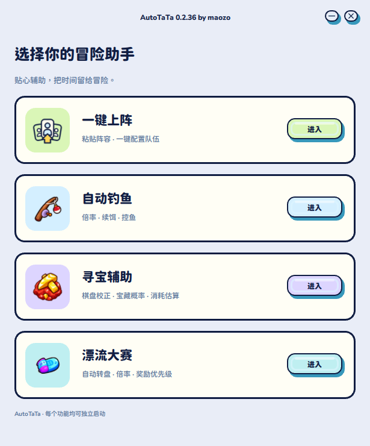
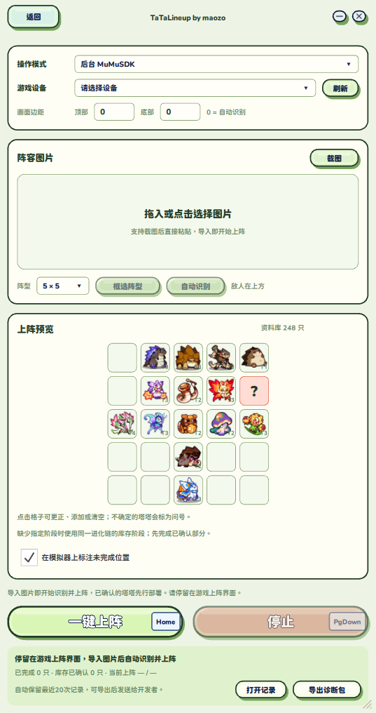
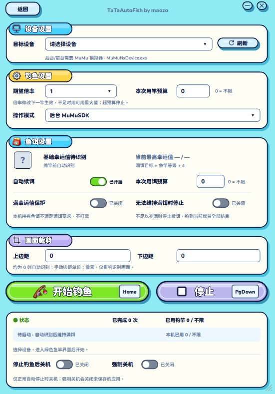
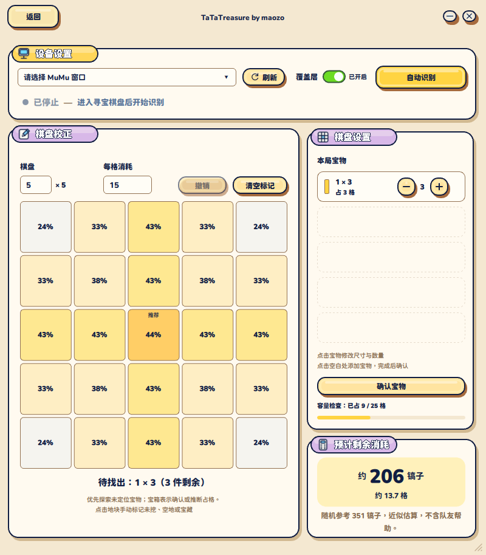
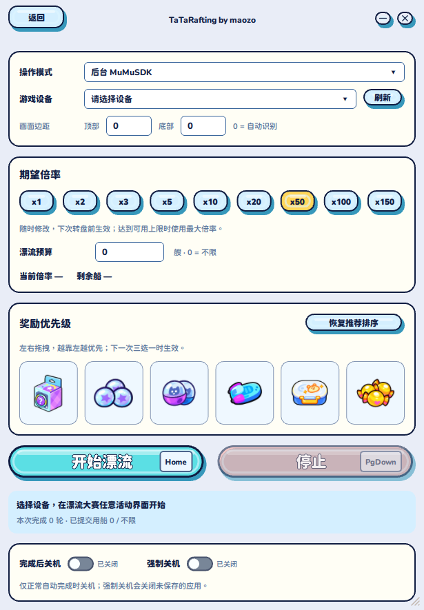
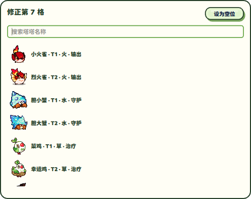

<p align="center"><strong>简体中文</strong> · <a href="README.en.md">English</a></p>

<p align="center"></p>

<p align="center"><strong>设计师主导 · AI 辅助开发 · Windows 桌面实践</strong><br />Source available · Noncommercial · Frozen at v0.2.36</p>

> **已停止维护｜最后功能维护：2026-10-24（0.2.36）。** 因个人时间安排，且已不再游玩该游戏，故停止维护。功能基于当时的游戏、MuMu 模拟器与依赖环境，不保证当前或未来最新版可用。Issues 已关闭，不提供更新、修复或技术支持。见 [维护状态](docs/MAINTENANCE.md)。

> **已知问题：** 部分下拉菜单存在点击穿透；手动添加塔塔的输入筛选失效；寻宝仍有识别错误，缺少真实高等级关卡的完整连续测试；完整游戏上阵仍待复测。详见 [问题清单](docs/KNOWN_ISSUES.md)。

# AutoTaTa

**把“我希望它这样工作”的设计判断，推进到真正运行的软件。**

AutoTaTa 是设计师 **[maozo](https://github.com/maozo233)** 用于**探究 AI 在设计和开发过程中可行性**的个人实验项目。以 AI 初稿为起点，在 Figma 中进行设计、调整与修改，再借助 AI 实现 Windows 桌面界面、图像识别与自动化流程，用截图回放和本机检查验证实际效果。

[查看界面](#界面预览) · [功能与交互](#四个功能一套交互语言) · [设计与 AI 协作](docs/DESIGN_AND_AI.md) · [已知问题](docs/KNOWN_ISSUES.md) · [使用与复现边界](docs/SOURCE_DISTRIBUTION.md)

## 界面预览

<p align="center"></p>

<table>
  <tr>
    <td width="50%"><strong>一键上阵</strong><br /></td>
    <td width="50%"><strong>自动钓鱼</strong><br /></td>
  </tr>
  <tr>
    <td><strong>寻宝辅助</strong><br /></td>
    <td><strong>漂流大赛</strong><br /></td>
  </tr>
</table>

截图为 0.2.36 的实际程序界面，采用无设备连接的配置示例与本地计算状态。示例阵容、预算和概率不代表现场运行结果；图中第三方素材的权利不因截图展示而转移。README 与 banner 提供中英文切换，图中的程序界面仍为中文。

## 四个功能，一套交互语言

| 功能 | 已实现的流程 | 设计关注点 |
| --- | --- | --- |
| 一键上阵 | 导入、拖入或粘贴阵容图；识别、逐格更正、查找与部署；支持 5×5 和 3×4 | 先显示可确认结果；不确定格保留问号；操作前后核对数量、位置与身份 |
| 自动钓鱼 | 设备与操作模式选择、倍率、补饵、用竿预算和开始／停止 | 把设置、运行反馈与停止方式放在明确的层级中；预算与关机操作单独说明 |
| 寻宝辅助 | 棋盘校准、宝物尺寸与数量配置、概率、推荐格和消耗估算 | 可手动纠错；解释估算性质；辅助判断，不自动挖掘 |
| 漂流大赛 | 页面识别、倍率、用船预算、六类奖励优先级与停止 | 用可拖拽的图形排序表达偏好；遇到购买或未知页面时停止／等待 |

四个功能共用一个桌面程序，提供统一 [Windows x64 all 包](https://github.com/maozo233/AutoTaTa/releases/tag/v0.2.36)，也保留源码独立入口。

### 不确定性也是界面的一部分

<p align="center"></p>

“识别出来”不等于“可以直接操作”。一键上阵把未知、缺失、超出范围与已确认结果分开显示，允许手动更正。缺少完整空行的截图会要求重截；程序不会通过强行拉伸三四行来编造五行阵容。

## 我负责什么，AI 参与什么

协作流程：**AI 初稿 → 作者在 Figma 中设计与改动 → AI 辅助实现代码 → 作者检查和调整实现效果**。

| 环节 | 设计师的判断 | AI 的参与与可查看证据 |
| --- | --- | --- |
| 产品与交互 | 定义任务、信息层级、反馈状态、停止和纠错边界 | 辅助拆解流程、实现状态与交互；见 [功能代码](autotata) 与 [界面](assets/ui) |
| Figma 设计与组件 | 基于 AI 初稿，在 Figma 中设计和修改页面布局、视觉层级、字号间距、组件及交互状态，并核对实现效果 | 提供初稿与方案参考，依据确认后的 Figma 设计辅助 QML 落地与适配；见 [设计迭代说明](docs/DESIGN_AND_AI.md#ai-初稿之后的-figma-设计迭代) |
| 图形与素材处理 | 选择素材、判断可读性和视觉结果，确认边缘与透明背景 | 部分入口和奖励图标使用 AI 辅助抠图；这些派生素材不因此变成作者原创版权资产 |
| 功能实现与验证 | 明确可接受结果，提供真实失败样本，决定保留不确定结果 | 辅助实现视觉识别、求解、回放与回归测试；见 [验证摘要](docs/VALIDATION_SUMMARY.md) |

AI 主要参与设计与开发过程。运行时识别使用本地计算机视觉、模板／特征匹配和 OCR。

更完整的过程与设计取舍：[设计与 AI 协作记录](docs/DESIGN_AND_AI.md)。

## 做到哪里，也停在哪里

0.2.36 曾完成 **197 项一键上阵回归**和本机原生窗口启动核验。两台机器的 40 条诊断记录去重为 25 张原图后，问号从 12 格降为 8 格，原先已确认的身份没有变化；缺行截图明确拒绝，而非强行补齐。

这些是对应历史环境的记录，不是现在或未来的正确率保证。诊断图和完整识别素材没有随本次源码展示分发；完整测试不能在缺少它们时原样复跑。0.2.36 的真实游戏完整上阵仍保留“待复测”边界。详见 [验证摘要](docs/VALIDATION_SUMMARY.md)。

仍未确认的格子位置、手动输入筛选问题、寻宝识别及高等级关卡验证缺口，以及“真实拖拽失败”和“旧观察值误停”的区别，见 [0.2.36 已知问题与验证边界](docs/KNOWN_ISSUES.md)。项目已结束维护，这份清单不构成后续修复承诺。

## 看代码与复现

| 位置 | 内容 |
| --- | --- |
| `assets/ui/` | Qt Quick 页面、基础控件与功能主题 |
| `autotata/` | 统一主页、导航、窗口与共享运行逻辑 |
| `lineup/` | 阵容识别、纠错、数量核对与部署流程 |
| `fishing/`、`treasure/`、`rafting/` | 功能逻辑、识别、求解与状态处理 |
| `tests/` | 回归测试源码；现场图片与游戏素材未分发 |
| `docs/` | 设计说明、界面截图、许可范围与复现说明 |
| `docs/legal/`、`licenses/` | 授权范围、免责声明、第三方来源与原许可证 |
| `scripts/`、`requirements/` | Windows 启动／构建批处理与构建依赖 |

启动脚本位于 `scripts/`；独立功能使用 `python -m lineup`、`-m treasure`、`-m fishing`、`-m rafting`。环境与资源条件见 [使用说明](docs/USAGE.md)。

源码展示快照**不等于完整可运行发行版**。游戏图包、识别模板、诊断数据、AGPL 关联 Android 适配器和第三方二进制未随快照提供。先用以下命令检查资源边界，不会连接设备或自动下载素材：

```powershell
python tools/check_source_assets.py
```

准备合法来源的必要资源后，才能按照 [历史使用说明](docs/USAGE.md) 和 [源码分发说明](docs/SOURCE_DISTRIBUTION.md) 研究本地运行。项目不提供资源获取授权、代练、托管、付费部署或支持服务。

## 授权、用途与维护状态

- **人工创作及 AI 创作部分**：纳入本项目的 AI 生成、修改或整理后的代码、界面、文档与自制图形，**与人工创作部分一样，须遵守 [PolyForm Noncommercial 1.0.0](LICENSE)，不因由 AI 生成而例外**。非商业源码可见，未获许可的商业性使用不在授权范围内；保留署名和许可，具体允许用途以原文为准。授权以作者有权许可的内容为限，第三方内容及游戏素材的 AI 派生处理保留原权利，详见 [授权范围](docs/legal/LICENSE_SCOPE.md)。
- **第三方内容**：依赖、字体、游戏美术及商标保留原权利与许可，不受作者的非商业限制重新覆盖。见 [第三方说明](docs/legal/THIRD_PARTY_NOTICES.md)。
- **使用风险**：非官方项目；不保证准确、兼容、持续可用或账号安全；免责以法律允许范围为限。见 [免责声明](docs/legal/DISCLAIMER.md)。
- **停止维护**：不承诺更新、修复、Issue／PR 处理或技术支持。见 [维护状态](docs/MAINTENANCE.md)。

<p align="center">Designed and directed by <a href="https://github.com/maozo233">maozo</a> · Built with AI assistance · Preserved as a finished experiment</p>
