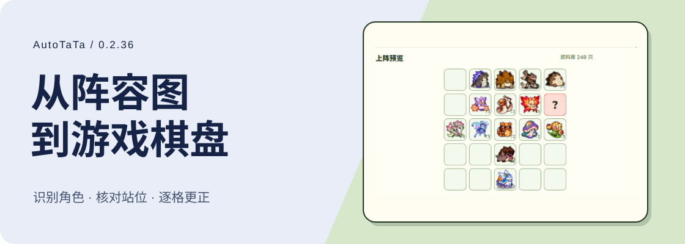
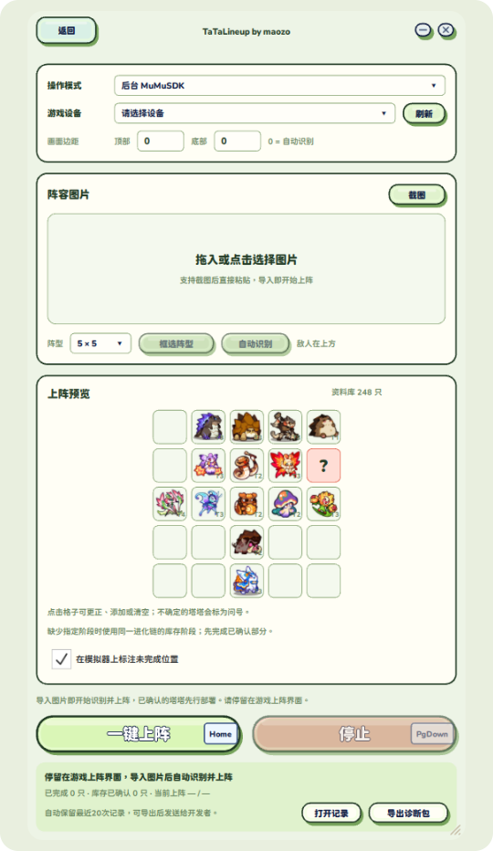
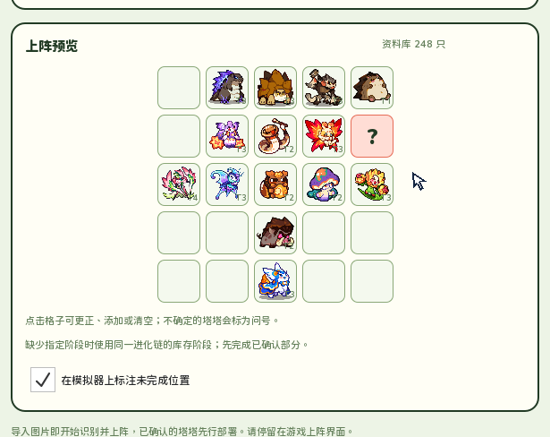
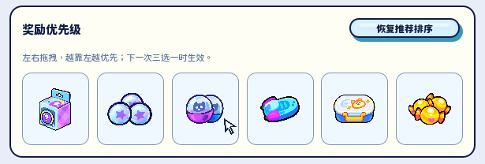
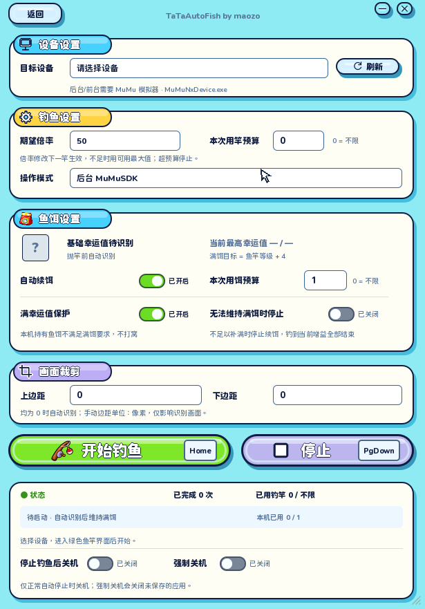

<p align="center"></p>
<h1 align="center">AutoTaTa</h1>
<p align="center">《塔塔冒险队》的非官方自动化工具，配合 Windows 上的安卓模拟器使用。<br />通过 ADB 或 MuMu SDK 连接模拟器，辅助上阵、寻宝、漂流和钓鱼。</p>
<p align="center"><strong>简体中文</strong> · <a href="README.en.md">English</a> &nbsp;·&nbsp; <a href="#交互演示">交互演示</a> &nbsp;·&nbsp; <a href="docs/KNOWN_ISSUES.md">已知问题</a></p>

<p align="center"><a href="docs/media/home.png"><picture><source media="(max-width: 600px)" srcset="docs/media/home.png" /></picture></a></p>

## 为什么做 AutoTaTa

照着攻略排阵，往往要在截图和模拟器之间来回切换，逐只翻库存、核对站位。钓鱼要守着浮漂，漂流每轮又要从相同的奖励里挑一次。AutoTaTa 让玩家用一张图指定阵容，提前排好想要的奖励、定好消耗上限。少查几遍攻略，少点几轮重复的按钮，把时间留给真正的冒险。

**Windows · 0.2.36 · 已停止维护**　点击任一窗口可查看原图。

<table>
  <tr>
    <td width="50%" valign="top"><div align="center"><a href="docs/media/lineup.png"></a></div><strong>一键上阵</strong><br />照着分享的阵容图自动排阵，逐格更正。</td>
    <td width="50%" valign="top"><div align="center"><a href="docs/media/fishing.png"></a></div><strong>自动钓鱼</strong><br />自动抛竿、控鱼，和队友配合补饵。</td>
  </tr>
  <tr>
    <td width="50%" valign="top"><div align="center"><a href="docs/media/treasure.png"></a></div><strong>寻宝辅助</strong><br />读取模拟器棋盘，比较未挖格的命中概率。</td>
    <td width="50%" valign="top"><div align="center"><a href="docs/media/rafting.png"></a></div><strong>漂流大赛</strong><br />调整用船倍率，拖动奖励卡决定优先级。</td>
  </tr>
</table>

## 交互演示

以下四段演示录自 0.2.36。每段先展示完整窗口，再跟随指针完成一次操作。阵容与棋盘使用示例数据，全程未连接游戏。

### 一键上阵 · 从一张阵容图排好队伍

把攻略截图或朋友分享的阵容图粘贴进来，AutoTaTa 会根据外观识别不同进化阶段的塔塔，读出它们的目标站位。部署时先核对场上队伍，保留已站对位置的塔塔。多余塔塔若挡住目标格就先下阵，再把站错格的塔塔移到位，收回其余多出的塔塔，最后从库存补齐缺口。缺少指定阶段时，可用同一进化链中的塔塔替代。

预览里的问号表示身份待确认。等本轮操作停止后，点开格子就能重新选择塔塔或设为空位。下面演示的是把第十格更正为空位。

<p align="center"><a href="docs/media/interaction-lineup.png"><picture><source media="(prefers-reduced-motion: reduce)" srcset="docs/media/lineup.png" /></picture></a></p>

截图范围影响站位。5×5 和 3×4 阵容都要保留完整己方场地。大截图可框掉敌方和底部按钮；如果五行棋盘已经截掉一整行，即使缺的是空行，也要重新截图。[阵容导入说明](docs/USAGE.md#一键上阵第一版)

### 寻宝辅助 · 看清下一铲的命中概率

开启自动识别后，助手通过 MuMu SDK 持续读取模拟器画面，根据宝物剪影判断形状和尺寸，再结合已挖出的空地和宝物占格，计算每个未挖格命中宝物的概率。棋盘变化后，确认新画面就会重新计算，玩家可以直接看着概率选下一铲。

也可以手动修正棋盘或宝物配置。演示中把中央推荐格标为「空地」，四周格子的概率随即更新，推荐位置也跟着改变。

<p align="center"><a href="docs/media/interaction-treasure.png"><picture><source media="(prefers-reduced-motion: reduce)" srcset="docs/media/treasure.png" /></picture></a></p>

### 漂流大赛 · 调整用船倍率，排好奖励顺序

运行中也能调整用船倍率，新设置会在下一轮转盘前应用。奖励按偏好从左到右排列。像演示里这样把第三项拖到最前，之后遇到三选一，助手就会自动挑选在场选项中排名最高的奖励。设好用船预算即可让转盘和领奖自动进行；免费转盘不占预算，遇到购船提示会停止。

<p align="center"><a href="docs/media/interaction-rewards.png"><picture><source media="(prefers-reduced-motion: reduce)" srcset="docs/media/rafting.png" /></picture></a></p>

### 自动钓鱼 · 控制用竿消耗，与队友配合打窝

助手自动抛竿、控鱼，也能和队友配合撒饵打窝。开启自动补饵后，它会结合鱼竿等级和当前幸运值判断是否需要撒饵。幸运值不足时会先等队友撒饵。队友补满就取消本次撒饵，等待结束后仍未补满，才按本机鱼饵库存和预算决定是否补饵。

鱼竿和鱼饵分别计数。演示把「本次用竿预算」从 0（不限）改为 30，下方「已用钓竿」随即显示 0 / 30。

<p align="center"><a href="docs/media/interaction-fishing.png"><picture><source media="(prefers-reduced-motion: reduce)" srcset="docs/media/fishing.png" /></picture></a></p>

## 设计取舍

- **按玩家要做的事组织入口。** 主页直接列出上阵、钓鱼、寻宝和漂流。选好任务，同一页就能找到相关设置、运行状态和停止按钮，途中调整也不用返回主页。[主页全图](docs/media/home.png)
- **让设置自己说明用途。** 钓鱼页写明「本次用竿预算」，旁边标出「0 = 不限」，下方同步显示已用数量和上限。漂流页把奖励排成一行，向左拖就能提高优先级。[钓鱼全图](docs/media/fishing.png)
- **把修正入口放在出错的位置。** 上阵预览里直接点问号就能更换塔塔；寻宝棋盘上也能就地标记空地或宝物，马上看到概率变化。玩家可以边看结果边纠正。[阵容编辑器](docs/media/lineup-editor.png) · [寻宝全图](docs/media/treasure.png)

## 设计分工与实现

AutoTaTa 也是一次关于 AI 在设计与开发中能做到什么的实验。产品范围、操作流程和视觉取舍由设计者确定。以 AI 初稿为起点，在 Figma 中重新组织布局、调整字号与组件状态，再对照 Windows 窗口核验还原效果。AI 辅助编写 QML 和 Python、整理失败样本与回归检查；最终由设计者判断识别结果是否可信、哪些操作应当停下。[设计与 AI 协作记录](docs/DESIGN_AND_AI.md)

界面采用 Qt Quick 和 PySide6。本地图像匹配与 OCR 读取画面，上阵流程核对角色身份、位置和数量。寻宝求解器枚举与标记相符的布局，搜索量过大时改用采样，并标明结果为估算。[界面组件](assets/ui) · [上阵实现](lineup) · [寻宝求解器](treasure/solver.py)

## 验证、已知问题与维护状态

两台机器的 40 条记录去重后得到 25 张原图。在同一组回放中，未确认格子从 **12 格降至 8 格**，原先已确认的角色身份保持一致。0.2.36 通过了 **197 项一键上阵回归检查**，该版本在游戏中从导入到完成上阵的全流程仍待复测。[历史验证摘要](docs/VALIDATION_SUMMARY.md)

- **一键上阵**仍会漏认或认错角色。手动添加或更正时，输入关键词有时无法缩小候选列表。
- **寻宝辅助**仍会认错棋盘。1–24 关有预设，高等级关卡缺少真实、连续的操作验证。
- **部分下拉菜单**会让点击穿透，触发下方控件。[完整已知问题](docs/KNOWN_ISSUES.md)

最后功能维护于 **2026-10-24**，**2026-10-28** 宣布停维。因个人时间安排及不再游玩，功能冻结于 0.2.36。兼容性以当时的游戏和模拟器版本为限，不保证最新版可用。Issues 已关闭，无后续修复排期。[维护记录](docs/MAINTENANCE.md)

## 源码与许可

仓库公开源码与设计资料，不提供整合安装包。游戏图包、识别模板、现场诊断图及部分运行依赖未随库分发。准备好文档列出的环境后，可在仓库根目录检查资源清单，或独立运行寻宝求解测试。[环境与复现说明](docs/SOURCE_DISTRIBUTION.md)

```powershell
python tools/check_source_assets.py
python -m unittest tests.test_treasure_solver tests.test_treasure_enumeration
```

作者有权授权的人工与 AI 创作部分均适用 PolyForm Noncommercial 1.0.0。商业性使用须另获许可，使用时须依许可原文保留相应声明。第三方软件、字体、商标和截图中的游戏美术保留各自权利。

[许可证](LICENSE) · [授权范围](docs/legal/LICENSE_SCOPE.md) · [第三方说明](docs/legal/THIRD_PARTY_NOTICES.md) · [免责声明](docs/legal/DISCLAIMER.md)

<!-- 如恢复作品集与联系入口，请在此另起二级标题。 -->
